# HIPI Board — User Manual

**HP-IL Pico Interface for the HP-41**

<!-- TODO image: replace the placeholder below with:
 -->
> 📷 **Image placeholder:** HIPI and an HP-41 connected and running (`images/hero-hipi-with-hp41.jpg`)

---

## Contents

1. [What is HIPI?](#1-what-is-hipi)
2. [What you need](#2-what-you-need)
3. [Getting started](#3-getting-started)
4. [Using the touch screen](#4-using-the-touch-screen)
5. [The views](#5-the-views)
6. [The menus](#6-the-menus)
7. [Cassette files](#7-cassette-files)
8. [HIPI's other devices](#8-hipis-other-devices)
9. [Connecting to a PC](#9-connecting-to-a-pc)
10. [Screen dumps](#10-screen-dumps)
11. [The HP-IL analyzer](#11-the-hp-il-analyzer)
12. [The settings file, CONFIG.TXT](#12-the-settings-file-configtxt)
13. [Updating the software](#13-updating-the-software)
14. [Troubleshooting](#14-troubleshooting)
15. [Words you may meet](#15-words-you-may-meet)

---

## 1. What is HIPI?

HIPI is a small box with a touch screen that connects to your HP-41, HP-71 or HP-75 through the
HP-IL module. To the device it looks like a whole set of classic HP peripherals
at once:

| HIPI acts as…                 | Original HP device        | Shows up as |
|-------------------------------|---------------------------|-------------|
| Video display                 | HP 82163 Video Interface — or the HP 92198 80-column one (a setting) | `TFDISPLAY` |
| Cassette drive                | HP 82161A Digital Cassette Drive | `TFDRIVE` |
| Plotter                       | HP 7470A                  | `TFPLOT`    |
| Any I2C chip: temperature, pressure, distance, clock ... | — | `TFI2C`     |
| LEDs and colour pixels        | —                         | `TFLEDS`, `TFPIXEL` |
| Link to a PC (e.g. pyIlPer)   | PILBox                    | `PILBOX`    |
| Terminal over USB             | —                         | `TFTERM`    |
| Thermal printer (7" view)     | HP 82162A Thermal Printer | `TFPRINT`   |

Cassettes are simply files on a micro-SD card, so you never run out of tape.

<!-- TODO image: replace the placeholder below with:
 -->
> 📷 **Image placeholder:** The finished HIPI unit, front view (`images/hipi-unit-front.jpg`)

<!-- TODO image: replace the placeholder below with:
 -->
> 📷 **Image placeholder:** The connectors — HP-IL IN/OUT, USB, SD card slot (`images/hipi-unit-connectors.jpg`)

---

## 2. What you need

- An **HP-IL Controller** device
  - E.g. a **HP-41** (C, CV or CX) with an **HP 82160A HP-IL module**
  - Or a **HP-71/75** with **HP-IL**
- The **HIPI unit**
- **HP-IL cables** — two, to make the loop with the HP-41
- A **micro-SD card** (FAT32 recommended)
- A **USB cable** and a USB power supply (or a computer)

---

## 3. Getting started

### 3.1 Prepare the SD card

The HIPI download contains two things: the software (a `.uf2` file, see
[chapter 13](#13-updating-the-software)) and **`HIPI-SD-card.zip`**, with
everything the SD card needs. (In the HIPI project it's in the main folder.)

1. Use a micro-SD card formatted as FAT32 (exFAT works too).
2. Unzip `HIPI-SD-card.zip` onto the card, keeping the folders.
3. Put your own cassettes (`.dat` files) in the `lif` folder — see
   [chapter 7](#7-cassette-files). There's one example cassette to start with.

The SD card then looks like this:

```
README.txt        a short note on what's what
CONFIG.TXT        HIPI's settings (created by HIPI itself)
resources/        the cassette drive's pictures: hp82161a.bmp,
                  tape-in.bmp, open.bmp, leds.bmp, reels.bmp
lif/              your cassettes (.dat files)
screenshots/      screen dumps (created by HIPI when you save the first)
logs/             analyzer logs (created when you start the first)
```

HIPI creates its settings file, `CONFIG.TXT`, by itself. The buttons, menus and start-up screen are built in, so HIPI can be used without an SD card too — just without cassettes, pictures and saved settings.

### 3.2 Connect everything

1. Turn the controller **off**.
2. Connect the controller's HP-IL **OUT** to HIPI's **IN**, and HIPI's **OUT** back
   to the controller's **IN**. HP-IL always forms a closed loop.
3. Insert the SD card (if you have one).
4. Connect USB power. HIPI starts.
5. Turn the controller on.


**Building HIPI yourself?** The HP-IL cables are soldered or screwed to the
board, and each wire must go to the right place (+ or −). How to tell which
is which — by the pin in the plug, not by the marking on the cable — is
described, with a picture, in
[Connecting the HP-IL cables](../pcb/README.md#51-connecting-the-hp-il-cables-jp5).

### 3.3 First start

HIPI shows its start-up screen: the version, and a **STATUS** list that fills
in line by line as HIPI starts — SD card, settings, the HP-IL loop, the
tape pictures, each cassette drive's file, the trace setting, USB and the
PILBox link to a PC program. A green dot means OK, red means something is
missing, grey means off.

The **PILBox** line changes as soon as a PC program (e.g. pyILPER) connects:
`waiting (TDIS)` until then, `connected (COFF)`, `(COFI)` or `(CON)` after
— the mode the program chose — or `disabled` if PILBOX is switched off in
**Devices**.

On the right, the **DEVICES ON THE LOOP** are shown in loop order: yellow
when switched on, grey when off.

After a few seconds (or when you touch the screen) HIPI is ready. Anything
the controller prints now appears on the screen.

<a href="images/screen-startup.png">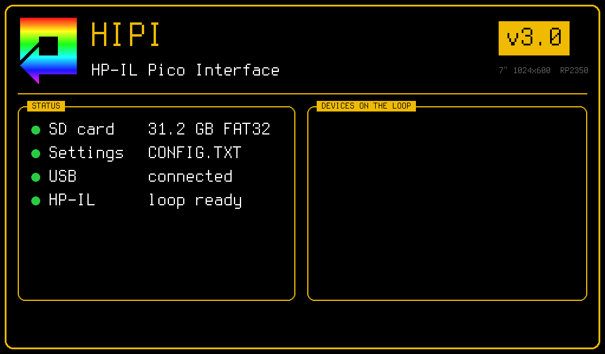</a>

<a href="images/screen-startup-ready.png">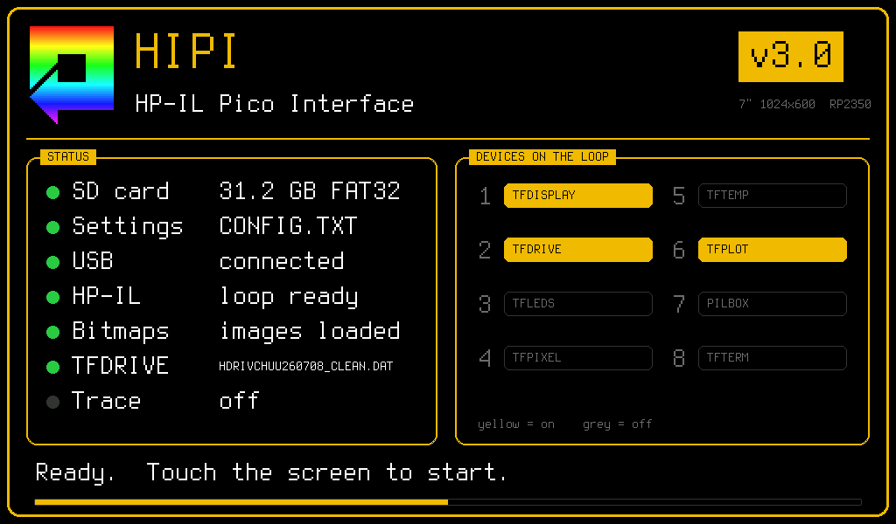</a>

---

## 4. Using the touch screen

### 4.1 The button strip

The buttons are hidden to give the text more room. **Touch the right edge of the
screen** to slide them in. They slide away again after 5 seconds without use.

<a href="images/screen-button-strip.png">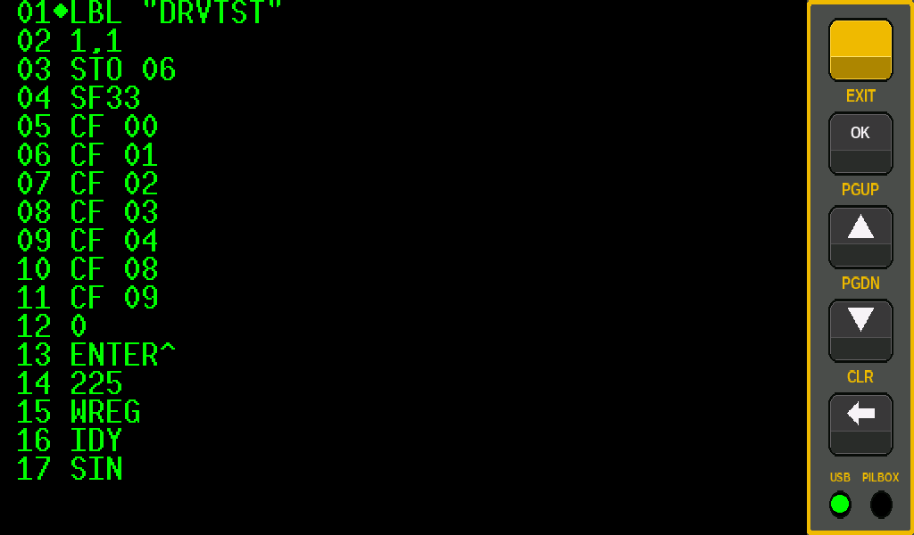</a>

| Button | Does | With **Shift** first |
|--------|------|----------------------|
| **OK** | Opens the menu / chooses | EXIT — closes the menu and hides the buttons |
| **▲**  | Scrolls text back one line / moves up | One page |
| **▼**  | Scrolls forward one line / moves down | One page |
| **X**  | Back to the live text / back one menu level; with no menu open and nothing to go back to, hides the buttons | CLR — clears the screen |

**Shift** is the yellow button at the top: tap it, then tap the other button.

### 4.2 Corners and swipes

| Touch | What happens |
|-------|--------------|
| **Top-left corner** | Info box: current file, settings, version (not on the Hardware test page) |
| **Bottom-left corner** | List of HIPI's HP-IL devices and their addresses. The PILBOX line shows the link to a PC program — `COFF`, `COFI` or `CON` when connected, `TDIS` when not — and the PC's devices with their addresses. Swipe up/down to scroll, a device at a time; the **✕** in its title closes it. (Not on the Hardware test page.) |
| **Swipe left or right** | Switch view. Each device with a view (display, plotter, cassette drive) has its own, in the order the devices are on the loop: swipe left for the next, right for the previous |

<a href="images/screen-infobox.png">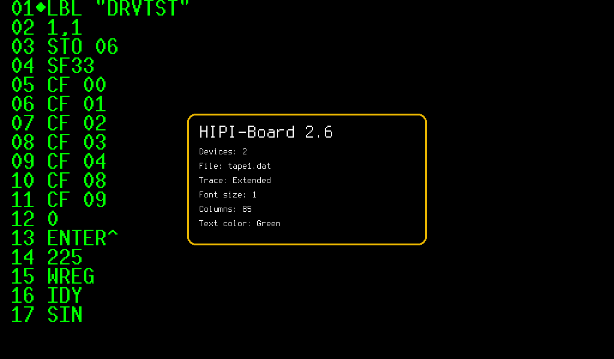</a>

<a href="images/screen-devicelist.png">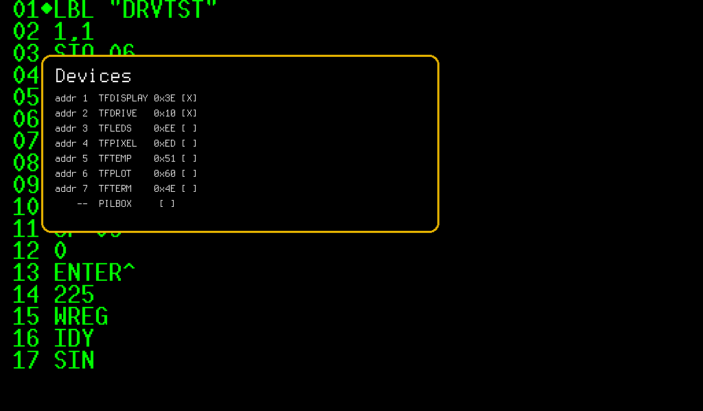</a>

When you switch view, a yellow box shows the name of the new view for a moment.
Touches are ignored while it's showing.

<a href="images/screen-swipe-splash.png">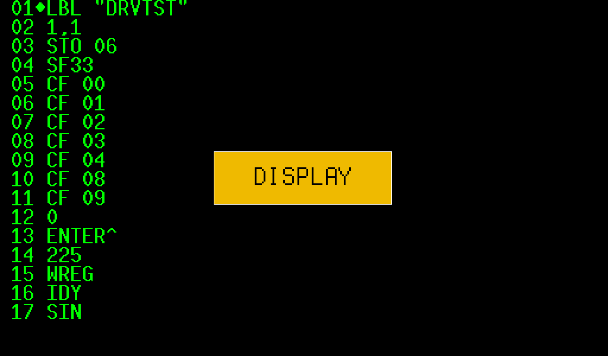</a>

### 4.3 Screen saver and clock

After 10 minutes without anything happening — no new text or drawing on the
screen, no touch — HIPI starts its screen saver. Choose what it does in
**More → Settings → Screen saver**:

| Setting | Choices |
|---------|---------|
| **Mode** | **Dim** (the default) — only the backlight goes down to 10 %; the screen keeps showing what it showed · **Clock** — a big clock fills the screen · **HP-IL rain** — HP-IL messages fall down the screen like in *The Matrix*, taken from the real traffic on the loop when there is any · **Goose** — the HP-41's "running" goose, in flocks of different sizes, flies across the screen · **Random** — HP-IL rain or Goose, picked anew each time the screen saver starts, in a random style (Dark or LCD) · **Off** |
| **No clock** | What Clock mode shows when there's no clock chip or its time isn't set: **HP-IL rain**, **Goose**, **Random** or **Dim** |
| **Style** | **Dark** — light on black · **LCD** — dark on a light background, like an old LCD (clock, rain and geese) |
| **Date** | **EU** — `2026-10-03` · **US** — `10/03/2026` |
| **Time** | **24 h** — `14:05` · **12 h** — `2:05 PM` |
| **Show now** | Starts the screen saver right away (the clock if the mode is Dim or Off), to try the settings |

With the clock, the rain and the goose the backlight also slowly dims to
10 %.

The clock, the rain and the geese get the whole screen: an open menu, the
button strip or a box in a corner goes out of the way while they run.

Anything new on the screen ends the screen saver at once and brings back
what was shown before, menu and button strip included. A touch also ends
it; that first touch only wakes the screen and doesn't press anything.

<a href="images/screen-clock.png">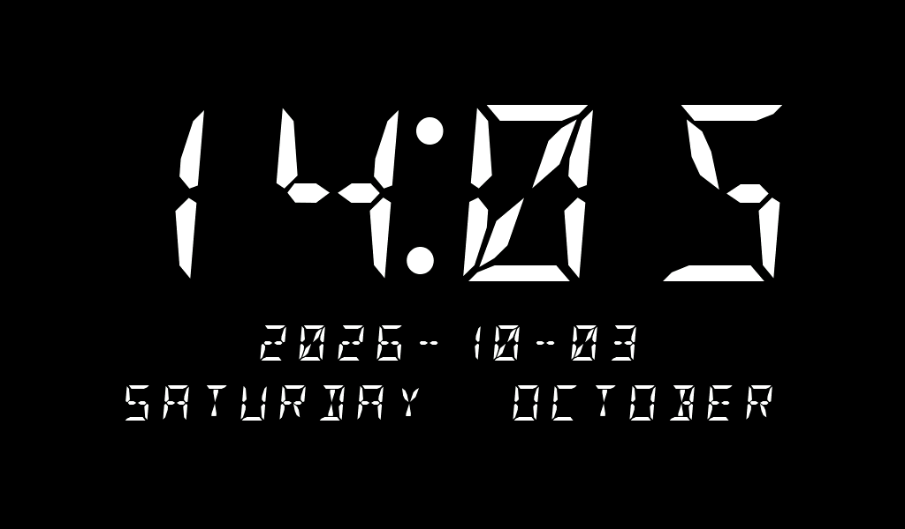</a>

**The clock needs a clock chip** (a DS3231 real-time clock module) connected
to HIPI, with its battery. Without it — or before its time has been set —
the screen saver shows what **No clock** says instead: HP-IL rain, the geese,
either of them at random, or just dimming.

**Setting the time:** connect HIPI to a computer with USB, open the debug
serial port in a terminal program (on Linux usually `/dev/ttyACM0`), type

```
time 2026-10-03 14:05
```

and press Enter (seconds can be added: `14:05:30`). Typing `time` alone shows
the clock's current time. The clock keeps its time on its battery, also
when HIPI is switched off.

**HP-IL rain.** A nod to *The Matrix*: instead of green code, HP-IL messages
rain down the screen — `RFC`, `TAD 01`, `SDA`, `DAB 41` — each column at its
own speed, with a bright head and a fading trail. Whenever there is traffic
on the loop, the rain is made of the real frames HIPI sees passing by; when
the loop is quiet, it makes them up.

<a href="images/saver_rain.png">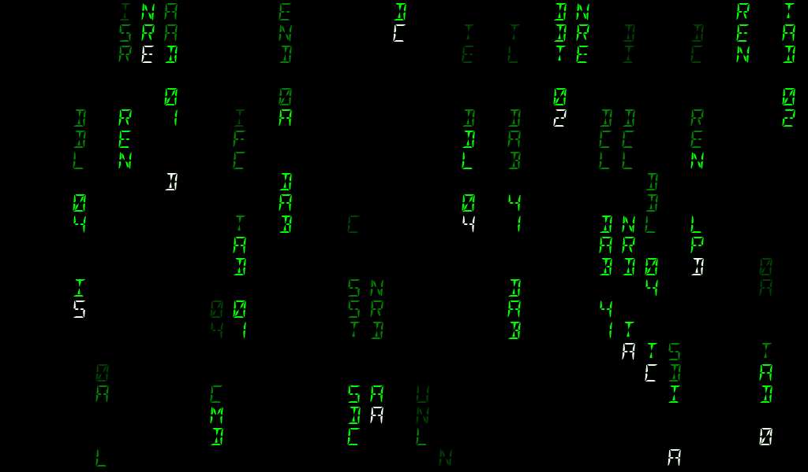</a>

**Goose.** Every HP-41 owner knows the little goose that flies across the
display while a program runs. Here it has left the calculator: flocks of
geese, big and small, fly across the screen from left to right, each at its
own speed — the program is still running somewhere.

<a href="images/saver_goose.png"></a>

---

## 5. The views

### 5.1 Display

The video display (`TFDISPLAY`): everything the controller prints, like `PRA`, `PRX` or
program listings. Scroll back with ▲ and ▼.

It is one of two displays — **Emulate** in its menu (OK) or in
**Settings → Screen** chooses:

- **HP 82163** (the default) — the HP 82163 Video Interface, 32 × 16, in
  HIPI's HP-41 style font. **Font size** and **Columns** set the size of
  the text and how many characters go on a line.
- **HP 92198** — the 80-column video interface (made by Mountain Computer
  as the MC00701A): 80 × 24 in the panel's own font, see
  [8.7](#87-the-display-as-an-hp-92198). **Font size** is *12x24* (large,
  the default) or *8x16* (small — the 5" panel only has this one);
  **Columns** is *80* (80 × 24) or *40* (40 × 20, double width) — what
  it starts with and goes back to after a reset. It keeps 48 lines: ▲/▼
  look back through them (Shift: a screen at a time), **X** goes back to
  the cursor (and when already there, hides the buttons), Shift + **X**
  clears the screen.

**Text colour** works for both, and each keeps its own font and columns.
The controller notices the change the next time it sets up the loop:
switch the HP-41 off and on (or run `AUTOIO`) after changing **Emulate**.

<a href="images/view-display.png"></a>

### 5.2 Plotter

Shows what the controller draws on the plotter (`TFPLOT`). The drawing keeps growing
while you look at other views. Clear it with **Clear plotter** in its menu (OK).

**Plot view** in its menu (OK) — or **Settings → Screen** — chooses how the drawing is placed on the screen:

- **Fit** (the default) — the drawing itself, with a small margin, as large
  as the screen allows and centred. It grows along as more is drawn.
- **Page** — the plotter's whole drawing area, like the paper. The
  plots don't sit in the middle of it (e.g. the plotter module leaves room for
  the axis labels), so they look shifted up and to the right.

Both keep the proportions: circles stay round and text undistorted.

**Paper** in the same menus chooses the paper colour:

- **White** (the default) — like real plotter paper: dark pens on white.
  Pen 1 is black, then red, blue, green and dark yellow.
- **Black** — inverted: light pens on black, easier on the eyes in a dark
  room. Pen 1 becomes white, and the other pens get brighter tones
  that show up well on black.

The drawing is redrawn at once in the new colours; nothing is lost.

<a href="images/view-plotter.png"></a>

### 5.3 Tape

A picture of the HP 82161A cassette drive — and you can use it like the real
thing.

<a href="images/view-tape.png">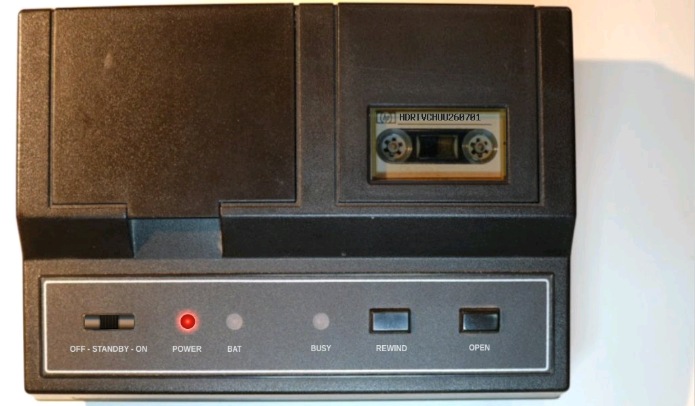</a>

| On the picture | What it does |
|----------------|--------------|
| **Cassette window** | Shows the cassette with the file name on its label. Touch it to pick another file |
| **OPEN** button | Opens the lid and the file list |
| **REWIND** button | Rewinds the tape (takes a few seconds; not while BUSY is lit) |
| **OFF–STANDBY–ON** switch | Touch to move it one step. OFF takes the drive off the loop; ON keeps it on; in STANDBY the controller can switch it off and on to save power |
| **POWER** light | The drive is on |
| **BUSY** light | The drive is working, or the controller is talking to it |
| **Reels** | Spin while the tape is read, written or wound |

<a href="images/view-tape-open.png">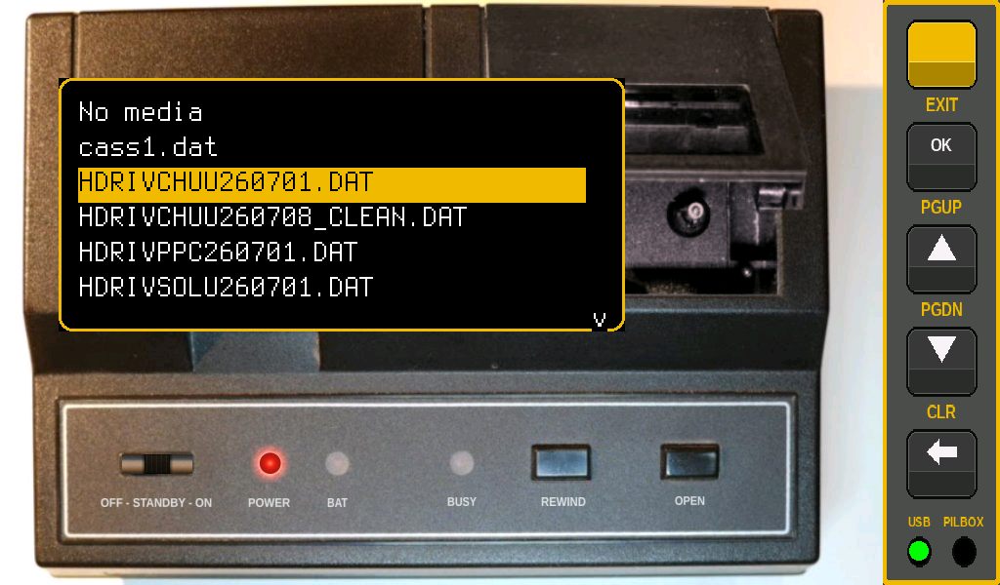</a>

### 5.4 Printer

A picture of the HP 82162A thermal printer (`TFPRINT`, 7" panel) — the
cassette drive's companion, the same size and look. Its controls work
like the real ones.

<a href="images/view-printer.png">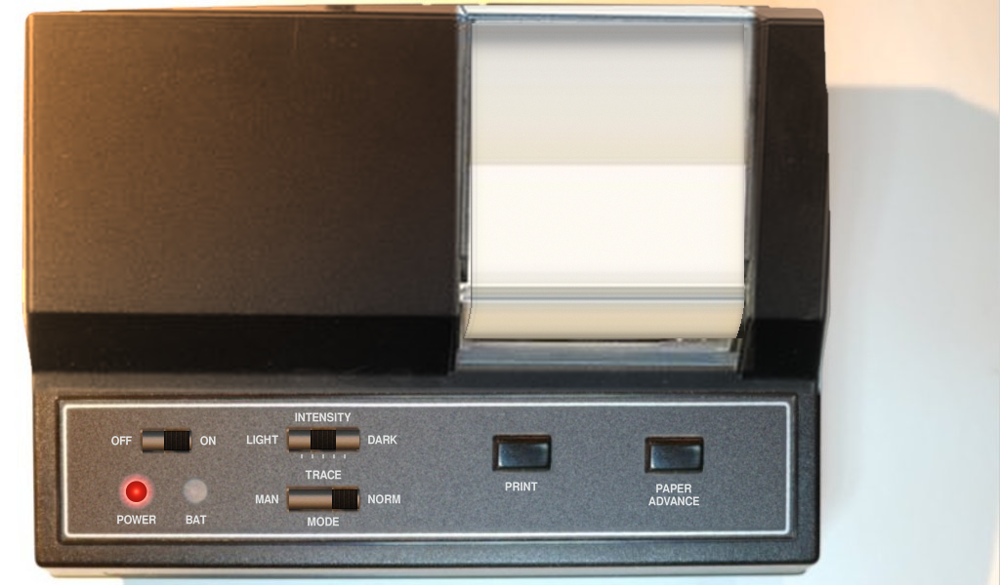</a>

| On the picture | What it does |
|----------------|--------------|
| **OFF–ON** switch | Puts the printer on the loop, or takes it off (like **Devices**) |
| **POWER** light | The printer is on |
| **INTENSITY** switch | How dark the print is, LIGHT to DARK. Touch a position, or LIGHT / DARK for one step |
| **MODE** switch | **MAN**, **TRACE** or **NORM** — touch the one you want. The controller reads it: the HP-41 prints only what you ask in MAN, also what you key in with NORM, and every program step in TRACE |
| **PRINT** key | Tells the controller the key was pressed, as the real printer does (the HP-41 prints the X register) |
| **PAPER ADVANCE** key | Feeds the paper one line — held, it keeps feeding — and tells the controller |
| **Paper window** | What has been printed, the newest line at the bottom. Like on the real printer, the print head — just visible in the slot under the paper — glides over to the other side while it prints, then the paper moves up and the line comes into view; the next line it glides back. PAPER ADVANCE (and an empty line) only moves the paper |

**Looking back on the paper.** Put a finger on the paper and drag it up or
down — it follows the finger and stays where you let go. Down shows older
lines, back to the first one (the last 200 lines are kept, until the paper
is torn off); up pulls the newest line out above the tear-off edge, where it
can be read. On the button strip: ▲/▼ a line, Shift+▲/▼ a window. As soon as
something is printed — or PRINT / PAPER ADVANCE, or **X** — the paper glides
back to the print head and printing goes on from there. Swiping sideways
still changes the view.

**Tearing off the paper.** Drag the paper up to the tear-off edge and,
without letting go, on sideways (left or right) — or choose **Tear off
paper** in the Printer view's menu. HIPI asks:

- **Save** — the paper is saved on the SD card in `printouts/`, then torn
  off: `printout_<n>.bmp`, a picture of the paper as printed (every dot
  2 × 2 pixels, black on white — HP-41 characters and graphics included),
  and `printout_<n>.txt`, the text of each line for copying a listing (a
  line of graphics only says `[graphics]`). The message box shows the name.
- **Discard** — torn off without saving.
- **Cancel** — the paper stays as it is.

On the button strip: ▲/▼ choose, **OK** picks, **X** is Cancel. The torn-off
paper slides away to the side, and the printer starts on fresh paper.

**Saved printouts.** **Printouts** in the Printer view's menu lists what
has been saved (`printout_<n>`, newest first, with its number of lines).
Pick one:

- **Load into the printer** — the printout replaces the paper in the
  printer, as it was when it was saved, so it can be looked at (and
  scrolled) again. Whatever was on the paper is gone — tear it off and save
  it first if it's wanted. New printing continues below it.
- **Delete** — after a question, both `printout_<n>.bmp` and
  `printout_<n>.txt` are removed from the SD card.

Loading reads the dots back from the `.bmp` and the text from the `.txt`,
so a picture edited on a PC comes back as edited (it must still be 352
pixels wide, 1 bit per pixel).

**The printer starts switched off.** With a printer on the loop, the HP-41
sends its printouts (`PRA`, `PRX`, listings) to the printer instead of the
video display. Switch it on when you want them on the printer. The view is
there either way — swipe to it and touch the switch.

The switch positions are remembered. The same settings are in the
Printer view's menu (OK): **Power**, **Mode** and **Intensity**.

**Switched it on, and nothing prints?** The controller gives the printer
its address when it sets up the loop. Switch the HP-41 off and on again
(or run `AUTOIO`) after switching the printer on — then `PRA "HELLO"`
prints. With **Trace** on, each printed line is also written to the
debug log.

**INTENSITY** works like on the real printer: it sets how dark the next
lines are printed; what's already on the paper stays as it is.

### 5.5 Choosing the view from the HP-41

A program can choose which view the screen shows, just like a swipe or
**Go to view** would. Send the escape sequence `ESC # V` followed by the
**HP-IL address** of the device whose view you want, with the display
device selected:

| Keys | Shows |
|------|-------|
| `27 ACCHR  35 ACCHR  86 ACCHR  3 ACCHR` | The view of the device at address 3 |

The last byte is the address itself (1–30) as a character code, not as
digits — `3 ACCHR`, not `51 ACCHR`. You find the addresses in the device list
(bottom-left corner), or with `FINDID` (Extended I/O module) in the program.

It follows what is actually on the loop: whichever HIPI device has that
address gets its view shown — today the display, the plotter, the
cassette drive(s) and the printer. If the address belongs to a device without a view
(e.g. `TFLEDS`), to a device that's switched off, to a device that isn't
part of HIPI, or to no device at all, **nothing happens** — no error, just a
warning in the log.

The yellow name box appears as usual. If a menu is open, the switch waits
until it's closed. A screen saver ends, and the chosen view is shown.

---

## 6. The menus

Press **OK** to open the menu. **▲/▼** to move, **OK** to choose, **X** to go
back. **Shift + OK** closes the menu from anywhere.

**The menu belongs to what you're looking at.** OK first opens the menu of
the view on the screen — the things you'd want to do right there, like
clearing the plotter in the Plotter view. Its last row, **More**, leads to
HIPI's own menu: going to another view, the settings, and the system
functions. The menu's name is always shown in the band at the top of its
frame, e.g. *PLOTTER* or *SETTINGS / SCREEN*.

Three kinds of rows:

- **Settings >** — a row ending in **>** opens another menu or dialog.
- **Clear plotter** — a row without one does it at once.
- **Plot view  < Fit >** — a setting, with its value at the right: **OK**
  changes it to the next value, at once and remembered.

Every menu has the same order: where to go, what to do, settings, then
**More**.

<a href="images/menu-display.png">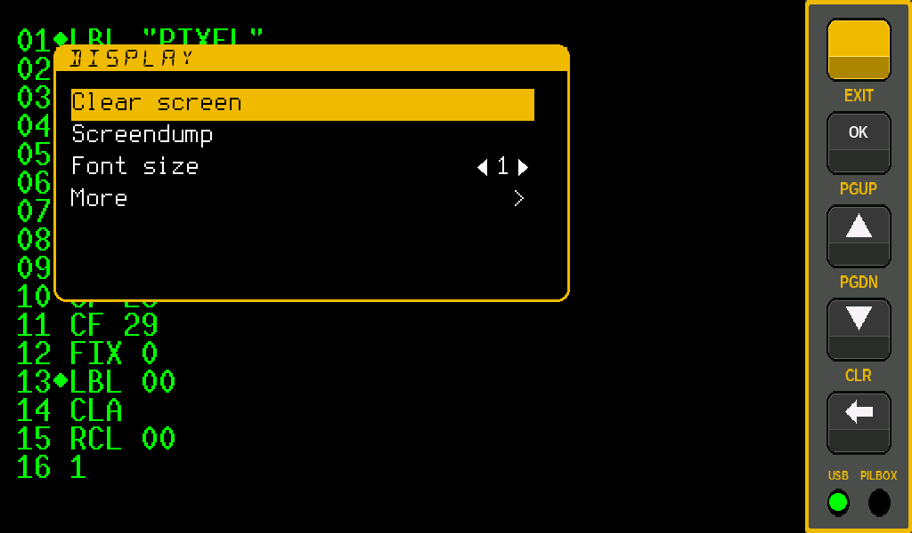</a>

```
OK in a view — that view's menu
├── DISPLAY          Clear screen · Screendump · Emulate < HP 82163 > ·
│                    Font size < 0 > · More >
├── PLOTTER          Clear plotter · Screendump · Plot view < Fit > ·
│                    Paper < White > · More >
├── TAPE TFDRIVE     Select cassette > · Media map > · Rewind · Power < ON > · Screendump · More >
├── ANALYZER         Leave view · Clear · Logging > · Mode < Overview > ·
│                    Time < Relative > · Idle frames < Hidden > · More >
├── LOOP MAP         Leave view · Screendump · More >
└── HP-IL SIGNALS    Leave view · Screendump · Bit cells < Bands > · More >

More > — HIPI's menu
├── Go to view >     Display · Plotter · Tape (one row per device) ·
│                    Analyzer · Loop map · HP-IL signals
├── Settings >
│   ├── Screen >         Emulate < HP 82163 > · Text colour < White > ·
│   │                    Font size < 0 > · Columns < Auto > ·
│   │                    Brightness < 100% > · Plot view < Fit > · Paper < White > ·
│   │                    Mirror to PC < Off >  (7" only: Off / View / Control)
│   ├── Screen saver >   Mode < Dim > · No clock < HP-IL rain > · Style < Dark > ·
│   │                    Date < EU > · Time < 24 h > · Show now
│   ├── Devices >        Enable/disable > · Change order > · Drive at start < ON >
│   └── PC link >        CON loop < Cable > · Trace < Off >
└── System >
    ├── Connect to PC    Show the SD card on your computer
    ├── Loopback test >  Test the HP-IL connection
    ├── Hardware test >  Try the LEDs, pixels and I2C chips
    ├── Demo             Show what HIPI can do (7" only)
    ├── Character table > The HP-41's character codes 0-127
    ├── About >          Version and hardware
    └── Bootsel mode     Get ready for a software update
```

(Screendump is on the 7" panel only.) All settings are remembered, also
after power off.

### A few worth knowing

- **Settings → Devices → Enable/disable** — each of HIPI's devices can be switched off. A switched-off device
  is gone from the loop, just as if it were unplugged. Handy if you have the
  real HP device connected too.
- **System → Hardware test** — try out what's connected, see
  [11.3](#113-hardware-test).
- **System → Demo** (7") — HIPI shows what it can do, on its own, see
  [11.4](#114-demo).
- **System → Character table** — a help page: the HP-41's character codes
  0–127 (decimal), each with the character as the HP-41's display shows it,
  over the whole screen. (Codes the HP-41 can't show appear with all
  segments on; for 102–125 the lower-case letters and `{|}` are shown
  instead.) Handy with `XTOA`/`ATOX` or when sending text to HIPI's devices.
  Touch the screen (or any button) to close it.
- **Settings → Devices → Drive at start** — where the cassette drive's power
  switch is when HIPI starts: **ON**, **STANDBY** or **OFF** (switched off,
  like in *Enable/disable* — not on the loop). To switch the drive right now,
  use **Power** in the Tape view's menu, or the switch on the picture.
- **Settings → Devices → Change order** — sets the order of HIPI's devices on the loop,
  which also decides their addresses. Pick a device with ▲/▼ and **OK**, move
  it with ▲/▼, and press **OK** to keep the new place (or **X** to put it back).
  The order is remembered; the controller hands out the new addresses the next time
  it sets up the loop.
- **Emulate** — the display is an HP 82163 or an HP 92198, see [5.1](#51-display).
- **Columns** — *Auto* fits the font size; *32* is the original HP 82163 width.
  As an HP 92198: *80* or *40*.
- **System → Loopback test** — connect HIPI's IN and OUT with itself (no controller),
  then run it. "Loopback OK!" means the HP-IL side works. (It can't tell if
  both cables have + and − swapped — see
  [Connecting the HP-IL cables](../pcb/README.md#51-connecting-the-hp-il-cables-jp5).)

<a href="images/menu-devices.png">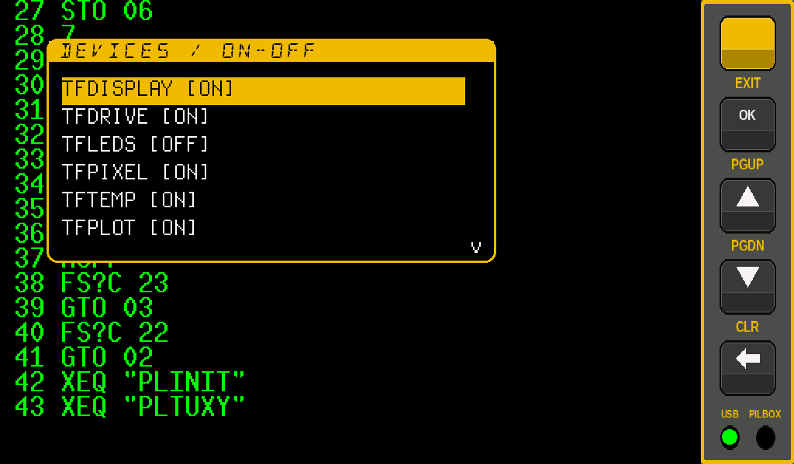</a>

<a href="images/menu-loopback.png">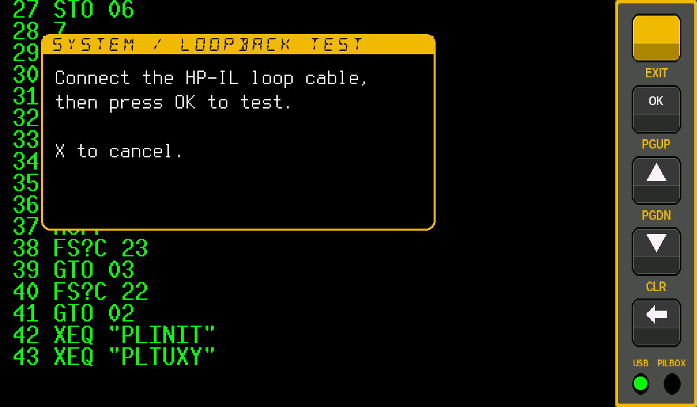</a>

---

## 7. Cassette files

Each `.dat` file on the SD card is one cassette.

### Adding cassettes

Copy your `.dat` files to the `lif` folder on the SD card — either with a
card reader, or straight from HIPI with **Connect to PC** (see
[chapter 9](#9-connecting-to-a-pc)).

### Choosing a cassette

Use **Select cassette** in the Tape view's menu (OK), or touch the cassette window in the Tape view.

<a href="images/menu-filelist.png">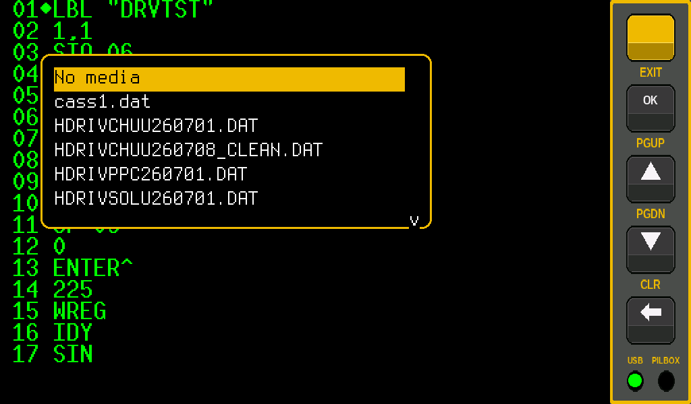</a>

- **No media** at the top means *no cassette in the drive*.
- **Create media...** (second) makes a new, empty cassette or disk, see below.
- After choosing a file you get three options:
  **OK** — use it, **X** — back to the list, **▼** — show what's on it.
- While the file list is open the drive has no cassette in it, just like a real
  drive with the lid open.

### Making a new cassette

**Create media...** in the file list makes a new, empty image in the `lif`
folder and puts it in the drive — no PC needed.

<a href="images/menu-create-media.png">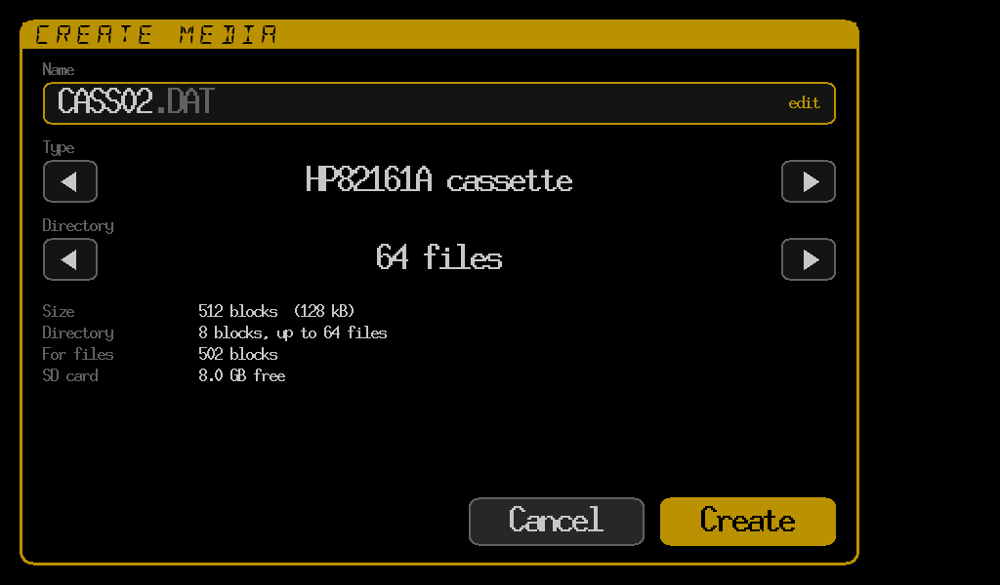</a>

- **Name** — a free name is filled in (`CASS01`, `CASS02` … for a cassette,
  `DISK01` … for the others); touch it to type another. `.DAT` is added.
- **Type** — ◀ ▶: an HP 82161A cassette (128 kB), an HP 9114B disk, or an
  HDRIVE1 disk of 640 kB, 2, 4, 8 or 16 MB (the medium types of `lifinit`).
- **Directory** — ◀ ▶: how many files the directory holds. 64 for a cassette,
  128 for the 9114B and 640 kB disks and 512 for the larger ones to begin
  with. The controller can format it again later with another size.
- Below: the size, how much is left for files, and the free space on the SD card.
- **Create** writes the file (a progress bar for the larger disks — **Cancel**
  stops it and deletes what was written) and the drive uses it at once.
  The volume label is the first 6 characters of the name, the date comes
  from the clock (if there is one and it's set, else it stays empty).
- Create can't be used while the name is taken (the name turns red) or the
  SD card is too full — the line above the buttons says why.

With the buttons: ▲/▼ move between Name, Type, Directory and Create, **OK**
picks (Type and Directory step to the next value), **X** goes back to the list.

**Typing the name**

<a href="images/menu-media-name.png">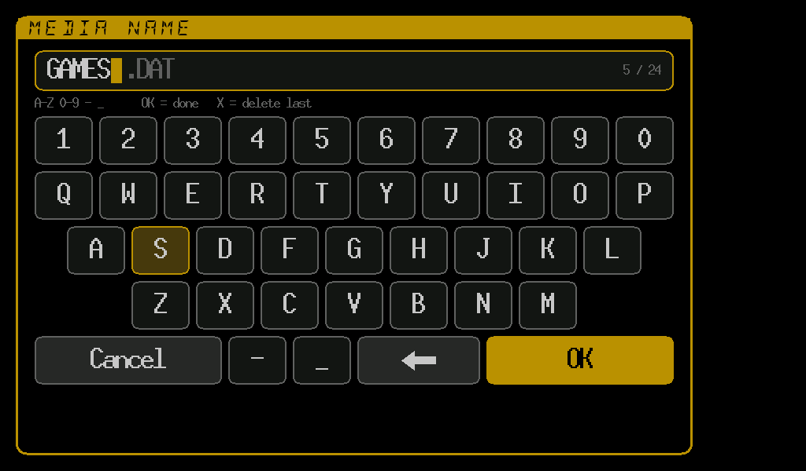</a>

Upper-case letters, digits, `-` and `_`, at most 24 characters. ← deletes the
last character, **OK** keeps the name, **Cancel** goes back without it. On the
button strip: **OK** = OK, **X** = delete the last character (back when the
name is empty).

While **Connect to PC** has the SD card, the row isn't there.

### What's on the cassette?

Press **▼** to see the cassette's contents: its name, size, free space and the
list of files with type and size (in registers, like the HP-41's `DIR`).
Scroll with ▲/▼ (Shift for a page), **OK** to use the cassette, **X** to go back.

<a href="images/menu-lif-contents.png">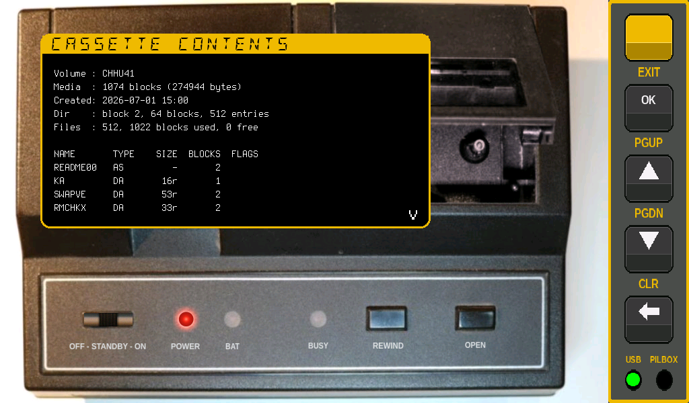</a>

### Media map

**Media map** in the Tape view's menu (OK) shows the drive's cassette or disk
as rings, coloured by what is stored where: programs, data, text, status /
key assignments / write-all, other (ROM, extended memory ...), **deleted**
files, free space, and the directory with the volume label.

<a href="images/view-mediamap.png">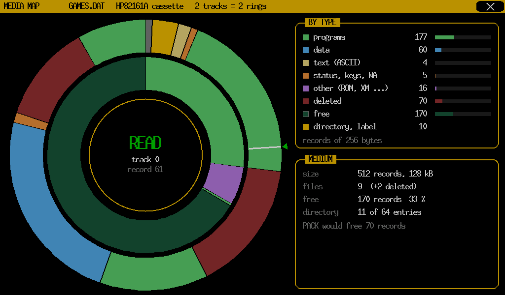</a>

- **A cassette** has two rings — its two tracks, track 0 outside. One step
  around a ring is one record.
- **A disk** has eight rings, outside in, like the cylinders of a disk. On a
  large disk a step holds several blocks (20 on a 16 MB disk); it shows the
  most important thing in them, so even a one-block file is never lost.
- **The head** is followed live: a white mark across its ring, a marker on the
  rim (green: read, orange: write, white: seek), and in the middle what the
  drive does where. After the drive has written something the map is read
  again.
- **Deleted** files (PURGE) still take their space until the controller packs
  the medium (`PACK` on the HP-41) — MEDIUM says how much that would free.
  New files go after the last one: *free* is the room left there.
- **Touch a ring** to see that file — its name, type, where it starts and its
  size — for a few seconds.
- **X** (on the strip or in the title bar) goes back to the Tape view.

<a href="images/view-mediamap-disk.png">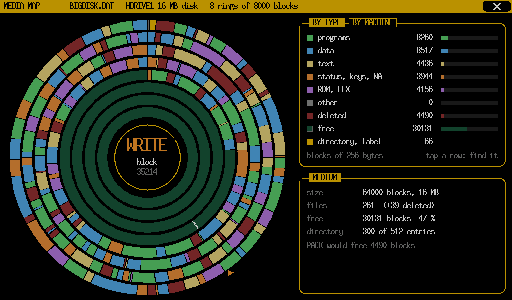</a>

---

## 8. HIPI's other devices

Besides the display and the cassette drive, HIPI has a few more devices you can
use from your controllers programs. You talk to them like any HP-IL device: **select** it
with its address, then send text with `OUTA` or read with `INA`.

**Finding the address:** touch the **bottom-left corner** of the screen. The list
shows each device's address — use that number with `SELECT`. The examples below
use the address 3; replace it with the one shown on your screen.

### 8.1 Plotter — `TFPLOT`

An HP 7470A pen plotter; the drawing appears in the Plotter view. It works e.g. with the
HP-41 plotter software, and you can also send plotter commands (HP-GL) yourself:

```
01 LBL "BOX"
02 3
03 SELECT
04 "IN SP1"
05 "⊢ PU1000 1000"
06 OUTA
07 "PD4000 1000"
08 "⊢ 4000 4000"
09 OUTA
10 "PD1000 4000"
11 "⊢ 1000 1000"
12 OUTA
13 "PU"
14 OUTA
15 END
```

This draws a square. Swipe to the Plotter view to see it.

Two things make plotter commands easy to type on the HP-41:

- **No `;` needed.** A new command letter, or the end of the text, ends a
  command, and numbers can be separated with spaces instead of commas —
  `PD4000 1000` means the same as `PD4000,1000;`.
- **Long commands are split** over two program lines, since one text line holds
  at most 15 characters. `⊢` is **APPEND** (in ALPHA mode: shift + K), which
  adds the text to what's already in ALPHA.

The following is the result from the example on page 13 in the Plotter Module (82184A) manual.

<a href="images/example-plotter-box.png"></a>

### 8.2 LEDs — `TFLEDS`

Controls the LEDs on the HIPI board. A command is the LED number(s) followed by
what to do; several commands can be separated by spaces.

LED 5 (D7) shares its pin (GPIO26) with the colour pixels' data line, so it
only works when no pixels are fitted (**Hardware test → PIXELS → Fitted:
NO**); with pixels fitted, commands for LED 5 do nothing.

| Send | Means |
|------|-------|
| `1O` | LED 1 on (`0` = all LEDs, `135` = LEDs 1, 3 and 5) |
| `1C` | LED 1 off |
| `2B5` | LED 2 blinks 5 times (`B` alone = forever) |
| `3B10:100:400` | LED 3 blinks 10 times, 100 ms on, 400 ms off |
| `0S50` | Brightness 50 % |
| `2F+800` | LED 2 fades on over 0.8 s (`F-` fades off) |

```
01 LBL "BLINK"
02 3
03 SELECT
04 "1B0:100:900"
05 OUTA
06 END
```

LED 1 now flashes briefly once a second, until you send `1C`.

<!-- TODO image: replace the placeholder below with:
 -->
> 📷 **Image placeholder:** HIPI with its LEDs lit (`images/example-leds.jpg`)

### 8.3 Colour pixels — `TFPIXEL`

Controls a strip of colour LEDs (NeoPixels) connected to HIPI. Pixels are chosen
like the LEDs: a number (`1` is the first pixel), `0` for all, or a range like `3-10`.

| Send | Means |
|------|-------|
| `0O` | All pixels on |
| `0C` | All pixels off |
| `0S30` | Brightness 30 % for the whole strip |
| `5X` + one colour byte | Pixel 5 gets a colour |

The colour byte is built as *red* (0–7) × 32 + *green* (0–7) × 4 + *blue* (0–3),
and added to the text with `XTOA` (HP-41CX, or the X-Functions module).
Full red is 7 × 32 = 224:

```
01 LBL "RED"
02 3
03 SELECT
04 "0X"
05 224
06 XTOA
07 OUTA
08 END
```

A few colours: red 224, green 28, blue 3, yellow 252, white 255.

**How many pixels?** HIPI can't see how many pixels are connected, so tell it
once with `N`, e.g. `0N10` for a strip of ten. HIPI remembers it (also after
power off). `0` ("all") then means these 10, and higher pixel numbers are
ignored. Until told otherwise HIPI assumes 5, the pixels on the board; at
most 32.

The pixels on the board and a strip get the same signal: the board's pixels
show exactly what the strip's first pixels show (pixel 1 on the board is
pixel 1 on the strip, and so on). So the number to give is the larger of the
two — with 5 on the board and a strip of 10, it's `0N10`, and pixels 1–5
light up both on the board and on the strip.

**Effects.** HIPI can also animate the pixels by itself — the HP-41 only
starts the effect. `E` and a letter start an effect on the pixels chosen
(nothing or `0` = all); several can run at once on different pixels (up to
four). Setting pixels with `C`, `O` or `X` stops an effect on them, and `E`
on its own stops the effects on the pixels chosen (`0E` stops them all).

| Send | Effect | Settings, in order (all can be left out) |
|------|--------|------------------------------------------|
| `0EC` | A comet running back and forth | colour : speed (pixels a second) : length : fade (higher = shorter tail) |
| `0EM` | Coloured bands rolling along | colours : band length : speed (negative = the other way) : space between bands |
| `0ES` | Twinkling stars | colours : stars a second : fade |
| `0EB` | Bouncing balls | number of balls : colours : gravity : fade |
| `0EF` | Fire (3 pixels or more) | intensity : spread : cooling |
| `0EO` | Fade out to black | how fast |
| `0ER` | A rolling rainbow | speed : colour step between pixels |
| `0E` | Stop the effects | — |

The settings are numbers after the letter: a `:` between settings, a `,`
between colours, and an empty one keeps its default — `0EC:20` is the comet
in its default colour at 20 pixels a second. Colours are the same numbers as
above (red 224 and so on), here written as digits. A few examples:

| Send | Means |
|------|-------|
| `0ER` | A rainbow over all pixels |
| `1-5ES255,252:4` | Stars on pixels 1–5 (also the board's), white and yellow, 4 a second |
| `6-10EC224:12:3` | A red comet, 12 pixels a second, 3 long, on pixels 6–10 |
| `0EM224,28,3:2:6` | Red, green and blue bands, 2 long, 6 pixels a second |
| `0EB3:224,28,3` | Three balls: red, green and blue |

```
01 LBL "XMAS"
02 3
03 SELECT
04 "0N10"
05 OUTA
06 "1-5ES255,252:4"
07 OUTA
08 "6-10EC224:12:3"
09 OUTA
10 END
```

Leave a space between two commands in one string: `"0N10 0ER"`.

**Power.** The pixels get their power from HIPI's USB. To keep within what
USB can give, HIPI turns the brightness down by itself when many pixels
would be bright at once (about 400 mA in all) — so 32 pixels in full white
come out dimmer than 5.

<a href="images/example-pixels.jpg">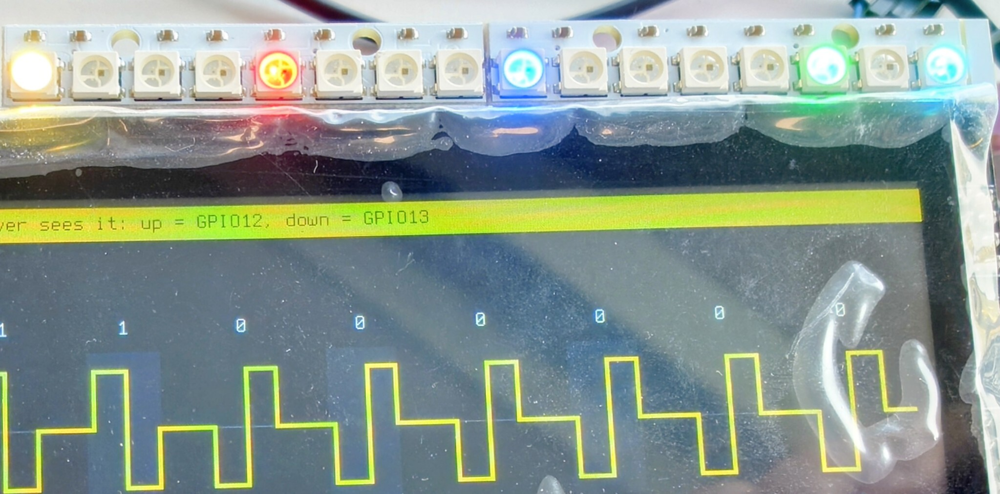</a>

### 8.4 Terminal — `TFTERM`

Makes a terminal program on your computer act as a display and keyboard on the
HP-IL loop — made for the HP-71B's `DISPLAY IS` and `KEYBOARD IS`. From the
HP-41, text sent to `TFTERM` with `OUTA` appears in the terminal program.

HIPI shows up on the computer as a few serial ports; the terminal is the
**third** one (on Linux usually `/dev/ttyACM2`). Open it in any terminal
program, for example PuTTY on Windows or `minicom` on Linux.

<!-- TODO image: replace the placeholder below with:
<a href="images/example-terminal.png"></a> -->
> 📷 **Image placeholder:** A terminal program on the PC showing text from the calculator (`images/example-terminal.png`)

### 8.5 PC link — `PILBOX`

Lets an HP-IL emulator on your computer, such as **pyILPER**, join the loop.
The emulator's virtual drives and printers then work with the controller as if they
were connected with cables. In the emulator, choose the **second** serial port
HIPI creates (on Linux usually `/dev/ttyACM1`) as its PILBox port.

When no emulator is running, `PILBOX` simply passes everything on.

The emulator chooses how PILBox works, and the device list (bottom-left
corner) shows it on the PILBOX line:

| Mode | Means |
|------|-------|
| `TDIS` | No PC program connected — PILBox just passes frames on |
| `COFF` | Connected; the controller is the loop's controller |
| `COFI` | As `COFF`, and idle frames (IDY) are passed to the PC too |
| `CON` | Connected; the PC program is the loop's controller (see below) |

**CON — the PC as controller.** In CON there is no controller on the HP-IL
loop: the PC program controls it, and HIPI starts every frame. HIPI's own
devices are on that loop too: PILBOX's place in the device order
(**Settings → Devices → Change order**) is where the loop begins and ends — the devices
after PILBOX come first, then the cable (HP-IL OUT → other devices → HP-IL
IN), then the devices before PILBOX.

**Settings → PC link → CON loop** chooses the loop:

- **Cable** (the default) — through the HP-IL cable, so a cable (or other
  devices) must go from HIPI's OUT back to its IN.
- **Internal** — closed inside HIPI: the PC reaches HIPI's own devices
  without any cable.

A warning box (touch to close) appears if a frame doesn't come back round
the loop within a second (is the cable connected?), or if frames arrive
that HIPI didn't send — another controller, such as an HP-41, on the loop.
Only one controller may be on a loop.

<!-- TODO image: replace the placeholder below with:
<a href="images/example-pyilper.png"></a> -->
> 📷 **Image placeholder:** pyILPER connected to HIPI's PILBox port (`images/example-pyilper.png`)

### 8.6 Printer — `TFPRINT`

An HP 82162A thermal printer, with its own view ([5.4](#54-printer)). To the
controller it is the real printer: accessory ID 32 (a printer), its
two status bytes, the MODE switch, the PRINT and PAPER ADVANCE keys.
The HP-41's print functions (`PRA`, `PRX`, `PRP`, `ACA`, …) find it by
themselves; from an HP-71 or HP-75 it is `PRINTER IS` like any printer.

It prints like the 82162A: 24 characters per line (12 double wide), the
HP-41 characters (◆, x̄, ←, α, β, Γ, Δ, σ, Σ, ∡ …) in 8-bit mode, lower
case, right-justified lines, character and column skips, and graphics
(column mode, `ESC *b<n>G`) — e.g. `PRPLOT` and `ACCOL`. Bar codes are
skipped. The last 200 lines are kept; the window shows the last 20.

It starts switched off — see [5.4](#54-printer).

### 8.7 The display as an HP 92198

With **Emulate** set to **HP 92198** ([5.1](#51-display)), `TFDISPLAY` is
an HP 92198 80-column video interface (Mountain Computer's MC00701A). To
the controller it is the real one: accessory ID 50 (a display), device ID
`MC00701A`, and its status (`$80`, then which modes are on). It is still
the loop's display, so the HP-41 prints on it as before; on the HP-71 or
HP-75 it is `DISPLAY IS` like any display.

Only CR, LF, BS and ESC are acted on. Lines longer than the screen go on
on the next line. When the cursor is on the last line, LF moves the
window down through the 48 lines; at the end everything moves up and the
first line is lost. The escape sequences, as in the owner's manual:

| Sequence | Does |
|----------|------|
| `ESC %` *c r* | Cursor to column *c*, row *r* of the screen (as character codes, from 0) |
| `ESC A` `B` `C` `D` | Cursor up, down, right, left |
| `ESC H` | Cursor home (top of the screen) · `ESC h`: top of the memory |
| `ESC J` / `ESC K` | Clear to the end of the screen / line |
| `ESC L` / `ESC M` | Insert / delete a line |
| `ESC N` / `ESC R` | Insert mode (underline cursor) / back to replace mode |
| `ESC Q` | Insert cursor only |
| `ESC O` | Delete the character at the cursor |
| `ESC S` / `ESC T` | Window down / up a line |
| `ESC >` / `ESC <` | Cursor on / off |
| `ESC [` / `ESC ]` | 80 × 24 / 40 × 20 (clears the screen) |
| `ESC k` / `ESC j` | ASCII set (128–255 inverse video) / Roman-8 set (accented letters) |
| `ESC Y` / `ESC Z` | Monitor mode on (control codes shown, nothing acted on) / off |
| `ESC E` / `ESC e` | Clear the screen / reset everything |
| `ESC /` `ESC =` `ESC z` | NTSC / PAL (only reported in the status) / self-test (always good) |

HIPI's own `ESC #` sequences ([5.5](#55-choosing-the-view-from-the-hp-41),
[10](#10-screen-dumps)) work here too. Unlike the HP 82163, `ESC %` reaches
every row and column (the 82163 only has 16 rows and 32 columns).

**`ESC %` from the HP-41.** Column and row are sent as *values*, not as
digits: column 0 is the byte 0, made with `0 XTOA` (typing `"0"` gives the
character "0", code 48). But `OUTA` doesn't send a 0 byte. To reach row 0
or column 0, send it with `ACA` instead, with the display as the device
the HP-41 prints to; `ACA` sends the bytes as they are. (The same goes for
the HP 82163 model.) For the top left corner `ESC H` is simpler, with no 0 bytes at all.
`OUTA` also adds CR LF at the end, which moves the cursor again; set flag 17
first to leave it out.

```
01 LBL "AT"         column in Y, row in X (both from 0)
02 CLA
03 27
04 XTOA             ESC
05 "├%"
06 X<>Y
07 XTOA             column
08 X<>Y
09 XTOA             row
10 ACA              the bytes as they are, 0 bytes too
11 END
```

### 8.8 Any I2C chip — `TFI2C`

Talks to the chips on HIPI's I2C connector for your program: read and
write their registers yourself, or ask for a **measurement** — what to send,
how long to wait, what to read and how to turn it into a number is
described in the folder `i2c/` on the SD card (see
[11.3](#113-hardware-test)), so a new sensor needs no new firmware.

Send a line with `OUTA`, read the answer with `INA`. Several commands can go
on one line, separated by `,` (or `;`): `A118,MT`. A `,` between numbers
stays inside its command (`R5,2`). Numbers are decimal (hex with a `$` in front,
as in data sheets: `$68`); answers are always decimal.

| Send | Does | `INA` gives |
|------|------|-------------|
| `A118` or `A$76` | Choose the chip at address 118 (0x76); it stays chosen | |
| `ABMP280` | ... or by its name (as the Hardware test page shows it) | |
| `MT`, `MTEMP` | A measurement, by one of its names (see below) | `21.4` |
| `L` | The chosen chip's measurements | `T,P` |
| `P2` | Two decimals for the measurements (`P` alone: as described) | |
| `R13` / `R$0D` | Read register 13 | `171` |
| `R5,2` | Read 2 bytes from register 5 | `17,168` |
| `R5:S16` | ... as one number: `U8`, `S8`, `U16`, `S16`, `U16L`, `S16L` (`L`: low byte first) | `-240` |
| `W$6B,0` | Write 0 to register 0x6B | |
| `W,172,51,0` | Write bytes to the chip (a command, no register) | |
| `Q7` | Read 7 bytes (no register) | `28,128,...` |
| `D80` | Wait 80 ms (at most 2 s on a line) | |
| `S` | The addresses that answer | `56,104,118` |
| `I` | What the chosen chip is | `DS3231 OK` |

Without a chip chosen, `M` takes the first chip on the bus that has that
measurement — with only one temperature sensor, `MT` is all you need.

A line with only `A` and `P` is done at once, so the chip can be chosen on
a line of its own: `"A$29" OUTA`, then `"MD" OUTA INA`. A line that only
reads is done again for **every** `INA`, so each `INA`
gives a fresh value. A line with `W` is done once, when it arrives.
Errors answer `ERR` and what went wrong: `NOACK` (the chip didn't answer),
`CHIP` (no chip chosen), `NAME` (no such chip or measurement), `CRC`,
`TIME`, `RANGE`, `SYNTAX` — and `HIPI`: HIPI's own touch panel can't be
written to. Everything else is up to you. `CLRDEV` (device clear) reads the
chip descriptions in `i2c/` again.

**Measurements that come with HIPI** (`chips.txt`):

| Chip | Measurements |
|------|--------------|
| BMP280 (0x76 or 0x77) | `T` temperature °C, `P` pressure hPa |
| VL53L0X | `D` distance in mm (8190: nothing in range); HIPI sets the sensor up itself |
| DS3231 clock | `TIME` 12.3456 (HH.MMSS), `DATE` 2026.1011 (YYYY.MMDD), `DMY` 11.102026 and `MDY` 10.112026 (the TIME module's forms), `T` temperature |
| AHT20, SHT3x, HTU21D | `T` temperature, `H` humidity % |
| TMP102, LM75, MCP9808 | `T` temperature |
| BH1750 | `L` light, lux |
| ADS1115 | `A0`–`A3` voltage (0–4.096 V) |
| INA219 | `V` bus voltage, `I` current (0.1 Ω shunt) |
| MPU-6050, ADXL345, LIS3DH | `AX` `AY` `AZ` acceleration g (MPU-6050 also `GX` `GY` `GZ`, `T`) |

**A temperature**, with a BMP280 (or an AHT20, a TMP102 ...) connected.
Use `TFI2C`'s address from the device list:

```
01 LBL "TEMP"
02 8              TFI2C's address
03 SELECT
04 "ABMP280,MT"   choose the sensor, measure T
05 OUTA
06 INA
07 AVIEW          21.4
08 END
```

With only one temperature sensor, `"MT"` alone is enough. But the DS3231
clock module has a temperature too, and comes first on the bus (0x68),
so with it connected, say which chip you mean: `ABMP280` or `A$76`.

**Two sensors at once** don't get in each other's way, each has its own
address. Choose one, read, choose the other:

```
"AVL53L0X,MD"  OUTA  INA   → 412      the distance, mm
"ABMP280,MT"   OUTA  INA   → 21.4     the temperature
```

**The clock** answers numbers the HP-41 can use straight away (`ANUM`):
`MTIME` gives `12.3456` (HH.MMSS, as `HMS+` and the TIME module), `MDATE`
gives `2026.1011` (YYYY.MMDD), and `MDMY` / `MMDY` the TIME module's date
forms `11.102026` / `10.112026` (flag 31 set / clear).

**The VL53L0X** needs a long set-up before it measures (calibration,
tuning); HIPI does all of it the first time you ask, and again if the
sensor was unplugged. `MD` takes about 35 ms.

A sensor of your own, e.g. a humidity sensor with a 2-byte reading after a
command — in `i2c/my.txt`:

```
chip 0x40 MYSENSOR | humidity
  measure H | humidity
    write 0xF5                 # start a measurement
    wait 20
    read 2
    value bytes=0-1 scale=0.0019 offset=-6 dec=1
```

The top of `i2c/chips.txt.example` on the SD card describes every word.

---

## 9. Connecting to a PC

To copy cassette files or screen dumps, you can reach the SD card from your
computer without taking it out:

1. Connect HIPI to the computer with USB.
2. Choose **More → System → Connect to PC**. The SD card appears on the computer as a
   USB drive.
3. Copy your files.
4. **Eject** the drive on the computer. HIPI notices and goes back to normal
   by itself. (Or choose **Disconnect from PC** in the menu.)

While connected, the cassette drive is paused and screen dumps are not possible.

<a href="images/pc-usb-drive.png">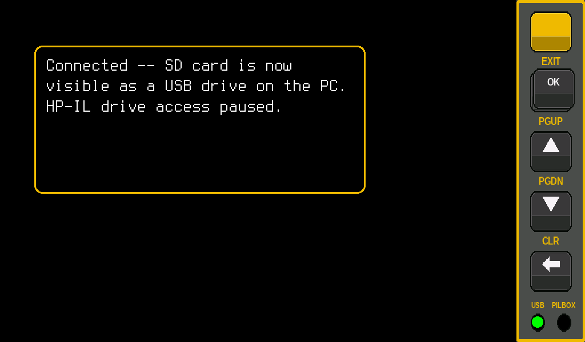</a>

<a href="images/menu-connect-pc.png">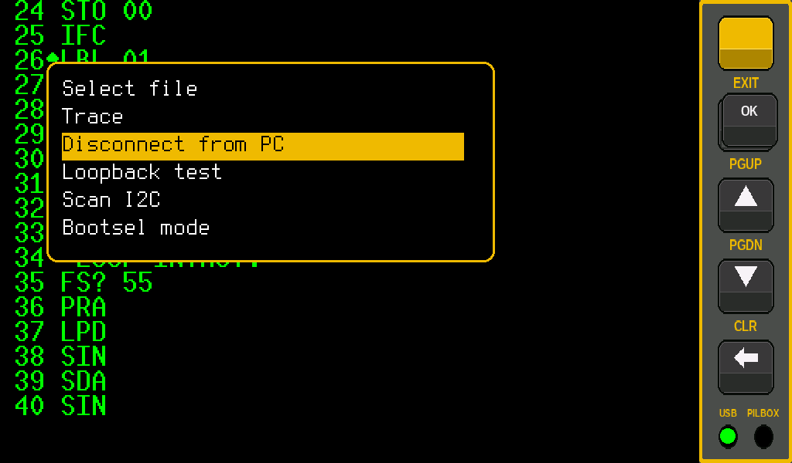</a>

---

## 10. Screen dumps

**Screendump** in a view's menu (OK) saves the screen as a picture in the `screenshots`
folder on the SD card: `screendump_0.bmp`, `screendump_1.bmp` and so on. It takes a few seconds; a
yellow box tells you when it's done. The menu itself is not in the picture.

You can also take one from e.g. a HP-41 program (with the display device selected):

| Keys | Saves |
|------|-------|
| `27 ACCHR  35 ACCHR  68 ACCHR` | Just the screen |
| `27 ACCHR  35 ACCHR  77 ACCHR` | The screen **with** menus and buttons, exactly as you see it |

To choose which view is in the picture first, see
[5.5 Choosing the view from the HP-41](#55-choosing-the-view-from-the-hp-41).

### Recording the screen on a PC (7" panel)

To make a video of HIPI, you don't need a camera. The PC program
**hipiview** (in `tools/hipiview`) shows HIPI's screen in a window,
exactly as on the panel (text, plots, menus, the screen saver, everything),
and records it straight to a video file.

First switch it on in HIPI: **More → Settings → Screen → Mirror to PC
< View >** (it's saved, and off from the start). Then connect HIPI with USB
and start `hipiview`. It finds HIPI's fourth serial
port, **HIPI Display Mirror**, by itself. The first few seconds it reads
what's already on the screen (the title bar shows how far it has come);
after that it follows along live. Press **R** to start and stop recording,
and **S** for a screenshot. HIPI works as usual meanwhile.

HIPI only sends anything while hipiview is running and has asked for the
screen; with hipiview closed, the mirror costs practically nothing. While
it is running, though, every drawing goes to USB as well, which makes the
heavier screens (the Tape view, the screen saver animations) a little
slower. With **Mirror to PC < Off >** HIPI ignores hipiview completely and
stops a running session at once; switching it on again while hipiview
is open starts sending again by itself.

**Using HIPI from the PC.** With **Mirror to PC < Control >**, the mouse
and keyboard in hipiview work HIPI as well: a click is a tap on the screen,
dragging is a swipe, **Enter** is OK, the arrow keys are ▲/▼ and the views,
**Backspace** is X and **Tab** is Shift. HIPI can then be used from its own
screen and from the PC alike. In a video, a ring shows where was clicked.

How to build and use it: see `tools/hipiview/README.md`.

---

## 11. The HP-IL analyzer

The analyzer shows what happens on the HP-IL loop: who talks to whom, what
is sent, status answers, and anything that goes wrong. It only listens — it
has no address and never changes anything on the loop. It records all the
time in the background, so you can open it *after* something went wrong
and see what led up to it.

Open it with **More → Go to view → Analyzer**. **▲/▼** scroll back and forth (Shift for
a page, hold to keep scrolling), **X** jumps to the newest line (already there: hides the buttons), **Shift + X**
clears it. **Touch the middle of the screen** to pause: the screen freezes
with a red PAUSED banner while recording goes on; touch again to resume.

<a href="images/analyzer-overview.png">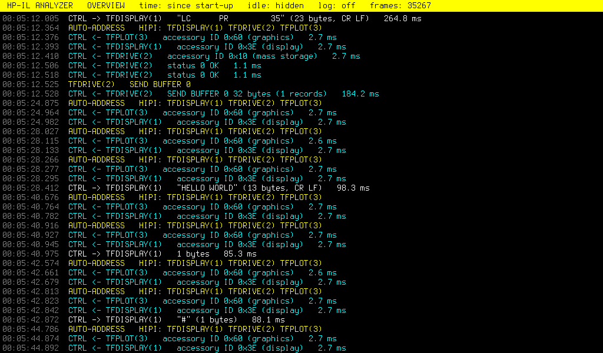</a>

**Overview** (the default) shows one line per event:

```
00:04:05.016  CTRL -> TFDISPLAY(1)   "HELLO WORLD" (13 bytes, CR LF)   26.0 ms
00:04:05.090  CTRL <- TFDRIVE(2)   status 23 NEW TAPE   2.0 ms
00:04:05.102  NO RESPONSE: SST to addr 3
00:04:05.118  TFDRIVE(2)   SEEK track 0 record 5
00:04:05.830  CTRL <- TFDRIVE(2)   READ 512 bytes (2 records)   41.0 ms
```

- **White and cyan:** data sent to and from devices, summarised. Text is shown
  as text, anything else as a number of bytes.
- **Yellow:** events such as auto-addressing, clearing the loop, the cassette
  drive's commands.
- **Red:** problems: no answer, transmission errors, slow answers (over half
  a second).
- Devices outside HIPI are shown by address, and by their type once they
  have told it (e.g. `addr 4 (printer)`). Devices in a PC program connected
  through PILBOX (e.g. pyILPER) are marked **PC**, e.g. `PC addr 4 (printer)`.
- The loop's controller — usually the HP-41 — is shown as **CTRL**, since HP-IL
  messages don't say who sent them.

**Detailed** shows every single message on the loop, explained.

Press **OK** in the analyzer for its menu:

| Menu item | Does |
|-----------|------|
| **Clear** | Empties the analyzer |
| **Mode** | Overview or Detailed — switching shows the recorded history again in the new mode |
| **Time** | Time since start-up, or time since the previous line |
| **Idle frames** | Hide or show the loop's idle polling |
| **Logging >** | **Start** / **Stop**: write everything from now on to a new file, `logs/analyzer_<n>.txt`. **Save**: when not logging, save what the analyzer holds right now to a new file — handy when something just happened. (Not while connected to a PC.) |
| **Leave view** | Back to the view you came from |

---

### 11.1 The loop map

**More → Go to view → Loop map** draws the HP-IL loop as a ring: the controller (usually
the HP-41) on the left, and every device in loop order around it with its
address, name, device ID and type. Yellow cards are HIPI's own devices, blue
ones the devices of a PC program connected through PILBOX (e.g. pyILPER),
orange ones other devices on the loop. The cards get smaller when there are
many devices, so up to 30 fit.

**Touch a card** to see everything known about that device — where it is,
its address, device ID and type, its status, when it was last used and how
much it has sent and received. Touch again to close the box. **X** leaves the
map.

<a href="images/loopmap.png">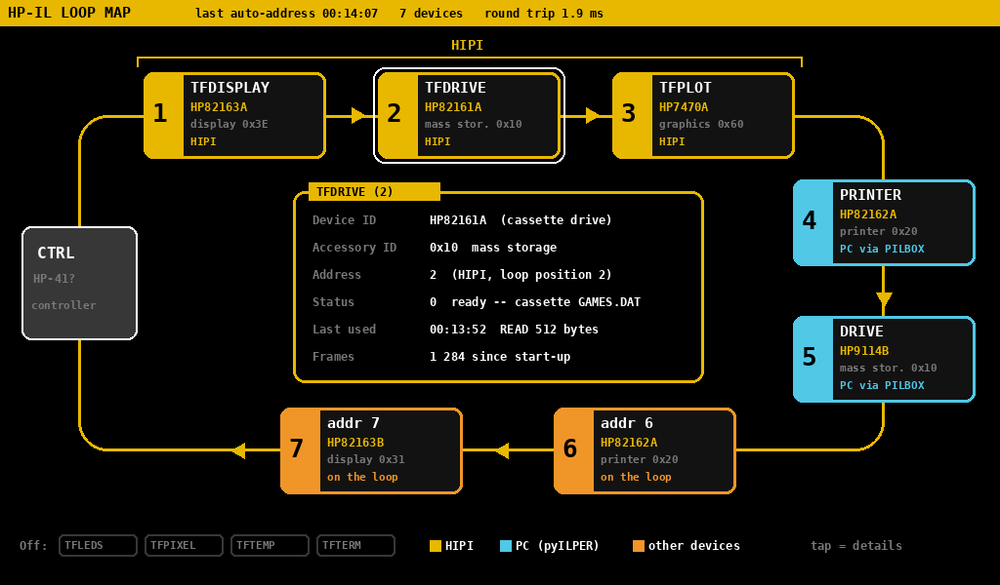</a>

HIPI only listens, so the map fills in as the loop is used: the addresses
come from the controller's auto-addressing, a device's type and ID once the
controller has asked for them (until then the card shows `?`), and devices that
sit after HIPI on the loop appear the first time the controller talks to them.

---

### 11.2 HP-IL signals (troubleshooting)

If the controller can't reach HIPI (TRANSMIT ERR) or if you experience other errors
you could check the signal, **More → Go to view → HP-IL signals** shows what actually arrives on HIPI's HP-IL
input, drawn like in the HP-IL specification: the first frame of a capture as
one line — up for a positive pulse, down for a negative one — with each
bit's value above it (the first one marked **sync**), the field names below
(C2 C1 C0 = control, D7…D0 = data), a time scale, and the frame it gives
(e.g. **SDA**, frame 0x560, ready). Below that: pulse widths, the frame's
length, and the whole capture (about 4 ms) small, with the name of every
frame found in it. If the receiver can't make a frame of what arrived, the
view says after how many bits it gave up.

A new capture every half second while traffic comes in. **X** leaves.

**Bit cells** in the view's menu (OK) chooses how the bits are told apart:

- **Bands** (the default) — a dark grey band behind every other bit.
- **Lines** — a thin line between the bits.
- **None** — nothing; the background is black all over.

<a href="images/signal-overview.png">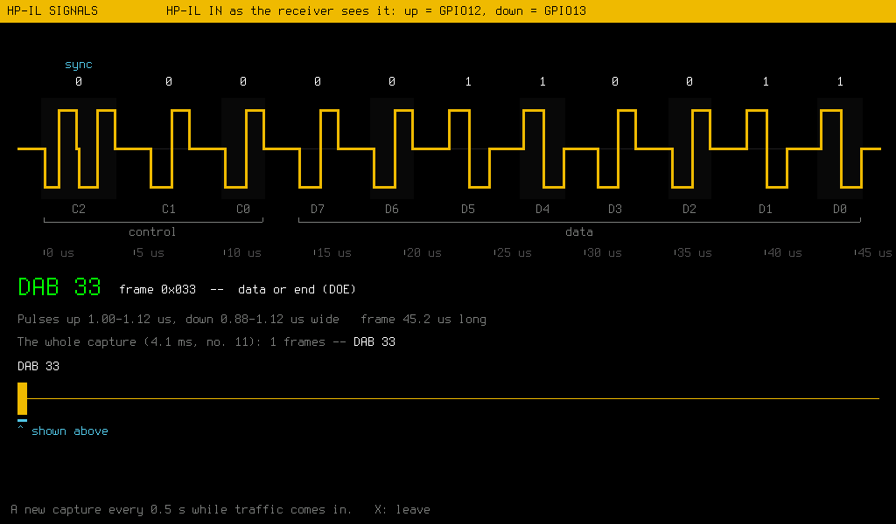</a>

### 11.3 Hardware test

**System → Hardware test** is a page for trying out what's connected to
HIPI: the five LEDs, the colour pixels and the chips on the I2C bus. Touch
the buttons; the **✕** at the top right closes the page. The page's
buttons reach the right edge, so there a touch goes to them; a touch at
the edge beside them brings up the button strip as usual, where **X** also
leaves and **OK** opens the page's menu (**Leave view**, **Scan I2C**,
**Screendump**). The corners don't open the info box or the device list
here (the page's buttons are there). While the page is open it drives the
LEDs and pixels itself — what the HP-41 had set on them is switched off
— and when you leave they are all off again.

<a href="images/view-hwtest.png">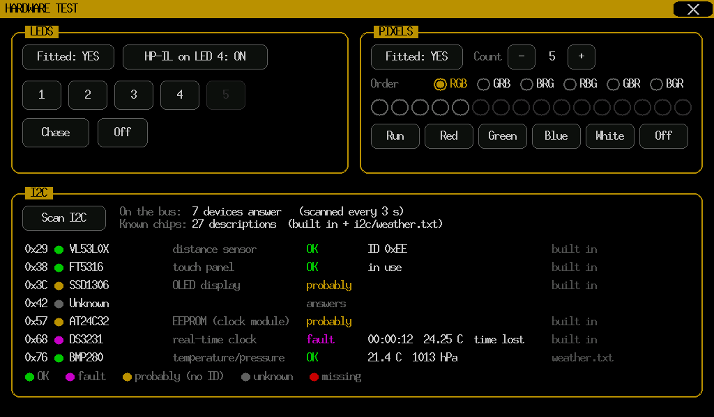</a>

**LEDS**

- **Fitted** — are the LEDs there? With *NO* the LED buttons do nothing.
- **HP-IL on LED 3+4** — *ON*: LED 3 flickers with HP-IL traffic and LED 4
  is lit while the loop is quiet. *OFF*: the two are free, for `TFLEDS` or
  whatever else you wire to those pins. Remembered.
- **1** – **5** switch each LED on and off. **Chase** runs a light from 1
  to 5 over and over; **Off** switches them all off. LED 5 shares its pin
  with the pixels: while **PIXELS → Fitted** is *YES* its button is greyed
  out and the chase stops at LED 4.

**PIXELS**

- **Fitted** — are colour pixels connected? With *NO* the buttons do nothing,
  and the pin (GPIO26) goes to LED 5 instead.
- **Count** − / + — how many are connected, 1–16. This is the same number
  the HP-41 sets with `0N<n>` (`pixel_count`), so it is remembered.
- **Order** — the order the pixels take their colours in: *RGB*, *GRB*,
  *BRG*, *RBG*, *GBR* or *BGR*. Pixels sold as WS2812/NeoPixel differ:
  the ones on the HIPI board take RGB, classic WS2812B take GRB, some
  WS2811 strings BRG. Touch **Red**, then try the orders until the pixels
  really are red; then check with **Green** and **Blue**. Remembered
  (`pixel_order`), and used for `TFPIXEL` too.
- The row of circles shows what is sent to the pixels.
- **Run** — one pixel at a time runs along the strip, quickly, in a new
  colour every round: red, green, blue, white. With only one or two pixels
  you still see it.
- **Red**, **Green**, **Blue**, **White** — all of them in that colour.
  If a colour comes out wrong, choose another **Order**.
- **Off** — all off.

**I2C**

Every address that answers on the I2C bus, looked at again every 3
seconds (so you can plug a sensor in while you watch). At the top of the
card, **On the bus** says how many addresses answer, and **Known chips**
how many chip descriptions HIPI has and where they came from: *built in*,
plus your own files in the SD card's `i2c/` folder (one is named and the
rest counted: *built in + i2c/my.txt and 2 others*). The last column of
the list says which file described each chip. The list shows seven chips; with more,
the last line says how many more there are, and **Scan I2C** shows them
all. For the chips HIPI knows, it says what it is and checks it:

| Dot | Means |
|-----|-------|
| green **OK** | Identified (its ID or a sensible reading), working — e.g. the clock's time and temperature, the BMP280's temperature and pressure |
| orange **fault** | Identified, but something's wrong — e.g. the clock has stopped or lost the time (battery?) |
| yellow **probably** | Answers on an address that chip uses, but it has no ID to check |
| grey **answers** | Something answers; HIPI doesn't know what |
| red **missing** | Should be there (the touch panel), doesn't answer |

**Scan I2C** shows every address in a grid, like Linux' `i2cdetect`;
touch to close it.

**Your own chips.** HIPI's own chip list (`chips.txt`) is built into the
firmware, so a new firmware brings its new chips and measurements. Your
own chips go in `.txt` files in the folder `i2c/` on the SD card — one
file for all of them, or one per chip (e.g. `i2c/my.txt`). HIPI reads them
first, so a chip described there wins over the built-in one. Add a chip,
then open the Hardware test page again: no new firmware needed. The card
has `i2c/chips.txt.example`, a copy of the built-in list to look at and
copy from; HIPI doesn't read it, and an `i2c/chips.txt` left from an
earlier version isn't read either (it would hide what the firmware knows
now — rename it if you changed something in it). The I2C card says what
was read, on the line *Known chips*; a line HIPI can't read is skipped and
written to the log. A chip looks like this — the top of
`chips.txt.example` explains every word:

```
chip 0x18-0x1F MCP9808 | temperature
  id16 0x06 0x0054                  # the manufacturer ID must read 0x0054
  show 0x05 u16 mask=0x1FFF bits=13 scale=0.0625 unit=C dec=2
  range -40 125                     # outside: shown as a fault
```

A chip with checks (`id`, `id16`, `text`, `status`, `show`) is tried
before one without, which is only *probably* that chip. HIPI only reads —
it writes nothing but the number of the register to read, and not even
that on 0x20–0x27 (a PCF8574 there would take it as its outputs).

### 11.4 Demo

**System → Demo** (7" panel) — HIPI shows what it can do, by itself, round
after round; handy for showing it to someone. A yellow caption at the
bottom says what you're looking at:

1. **The display** as an HP 82163: a title and a program listing typed out,
   cursor addressing and inverse video, the four font sizes and the text
   colours.
2. **The same display as an HP 92198**: 80 columns, inverse video, accented
   letters (Roman-8), then 40 columns.
3. **The cassette drive**: the lid opens, the cassette list appears and a
   cassette is picked, the lid closes and the reels turn — then **DIR**
   shows on the display what's really on that cassette.
4. **The plotter**: the HIPI logo on black paper, a spirograph (with a
   screendump, as a flash), a function plot and a drawing of the HP-IL loop.
5. **The printer** prints a few lines, HP-41 characters and a little graph.
6. **The analyzer** with a made-up HP-41 session (the loop set up, every
   device asked who it is, a line sent to the display), the **loop map**
   learnt from it, and the **HP-IL signals**.
7. The start-up box with the version, the LEDs and pixels running (if
   fitted, see [11.3](#113-hardware-test)), and a screen saver before the
   next round.

**Any touch stops it**, and so does real HP-IL traffic — the demo is meant
for showing HIPI, not for use alongside a controller. You're back in the
view you started from.

**Recording it with hipiview** (Mirror to PC *View* or *Control*): with
hipiview connected the demo waits for it — while hipiview is still getting
the whole screen, and before each step until it has caught up — so the
recording gets every step whole. Pauses and captions keep their length;
the demo just takes a little longer. Without hipiview it runs at its usual
pace.

Nothing is saved or changed: the font size, colours and plot settings are
only changed on the screen and put back, the cassette isn't really
chosen, and HIPI's loop addresses are put back. Afterwards the display,
the plot, the printer's paper and the analyzer are empty.

---

## 12. The settings file, CONFIG.TXT

HIPI keeps its settings in `CONFIG.TXT` in the root of the SD card. It
creates the file itself at the first start and writes it again whenever a
setting is changed in the menus — so normally you never need to touch it.
But it is a plain text file, and it can be edited on a computer: take the SD
card out, or connect HIPI with USB (**System → Connect to PC**) and open it
on the SD card drive. The new settings are used at the next start.

**The format:** one setting per line, `name=value`. Spaces around the name
and the value are allowed; lines starting with `#` are ignored, and so are
names HIPI doesn't know. Settings missing from the file get their default
value.

> **Good to know:** as HIPI writes the whole file again when you change a
> setting in a menu, your own comments and the order of the lines are not
> kept — only the settings themselves.

### The settings

**Cassettes**

| Setting | Values | Default | What it is |
|---------|--------|---------|------------|
| `media.<drive>` | a file name | — | The cassette in a drive: a LIF file in the `lif/` folder, e.g. `media.TFDRIVE=GAMES.DAT`. One line per drive. Empty = no cassette. (`filename=` from older versions still works for `TFDRIVE`.) |
| `drive_standby` | `0` / `1` | `0` | The cassette drive's power switch at start: `0` = ON, `1` = STANDBY. OFF is the drive in `disabled_devices`. (**Settings → Devices → Drive at start** sets both.) |

**Screen**

| Setting | Values | Default | What it is |
|---------|--------|---------|------------|
| `textcolor` | `0`–`65535` | `65535` | Text colour of the display view, as an RGB565 number. The menu's colours: `65535` white, `65504` yellow, `2016` green, `2047` cyan, `63488` red — any other RGB565 value works too. |
| `fontsize` | `0`–`3` | `0` | Text size of the display view (**Settings → Screen → Font size**). |
| `display_model` | `82163` / `92198` | `82163` | Which display `TFDISPLAY` is (**Settings → Screen → Emulate**). |
| `v80_font` | `large` / `small` | `large` | As an HP 92198: the 12 × 24 or the 8 × 16 font (**Font size**; the 5" panel is always small). |
| `v80_columns` | `80` / `40` | `80` | As an HP 92198: 80 × 24 or 40 × 20 at the start and after a reset (**Columns**). |
| `columns` | `0`, `1`–`100` | `0` | Characters per line; `0` = as many as fit. (The menu offers 25, 32 — the HP 82163's own — 33, 50 and 100.) |
| `brightness` | `0`–`255` | `255` | Backlight. The menu's steps: `51`, `102`, `153`, `204`, `255` (20–100 %). |
| `plot_fit` | `1` / `0` | `1` | Plotter view: `1` = Fit (the drawing fills the screen), `0` = Page (like the paper). |
| `plot_paper` | `white` / `black` | `white` | Plotter paper: `white` = dark pens on white, `black` = inverted, light pens on black. |
| `signal_cells` | `bands` / `lines` / `none` | `bands` | HP-IL signals view: how the bits are marked — shaded bands behind every other bit, thin lines between them, or nothing. |
| `hpil_leds` | `0` / `1` | `1` | HP-IL traffic on LED 3 and 4 (**Hardware test → HP-IL on LED 3+4**). `0` leaves them to `TFLEDS`. |
| `leds_fitted` | `0` / `1` | `1` | **Hardware test**: the LEDs are fitted. (Only the test page uses it, for now.) |
| `pixels_fitted` | `0` / `1` | `1` | **Hardware test**: colour pixels are connected. GPIO26 drives the pixels with `1`, LED 5 with `0`. |
| `pixel_count` | `1`–`32` | `5` | `TFPIXEL`: how many colour pixels are connected — set by the HP-41 with `0N<n>` (see [8.3](#83-colour-pixels--tfpixel)). |
| `pixel_order` | `RGB` `GRB` `BRG` `RBG` `GBR` `BGR` | `RGB` | The order the colour pixels take their colours in (**Hardware test → Order**). |
| `printer_mode` | `man` / `trace` / `norm` | `man` | `TFPRINT`: the MODE switch in the Printer view. |
| `printer_intensity` | `0`–`4` | `2` | `TFPRINT`: the INTENSITY switch, `0` = LIGHT … `4` = DARK. |
| `display_mirror` | `off` / `view` / `control` | `off` | 7" panel: send the screen to **hipiview** on a PC; `control`: the PC's mouse and keys work HIPI too (**Settings → Screen → Mirror to PC**). See [Recording the screen on a PC](#recording-the-screen-on-a-pc-7-panel). |

**Screen saver** (see [4.3](#43-screen-saver-and-clock))

| Setting | Values | Default | What it is |
|---------|--------|---------|------------|
| `saver` | `0`–`5` | `0` | What happens after 10 minutes without use: `0` Dim, `1` Clock, `2` Off, `3` HP-IL rain, `4` Goose, `5` Random (rain or goose). |
| `clock_fallback` | `0`, `3`, `4`, `5` | `3` | What Clock mode shows without a usable clock chip: `0` Dim, `3` HP-IL rain, `4` Goose, `5` Random. |
| `clock_style` | `0` / `1` | `0` | `0` Dark (light on black), `1` LCD (dark on light). |
| `clock_us` | `0` / `1` | `0` | Date format: `0` EU `2026-10-03`, `1` US `10/03/2026`. |
| `clock_12h` | `0` / `1` | `0` | Time: `0` 24 h, `1` 12 h with AM/PM. |

**Devices and the loop**

| Setting | Values | Default | What it is |
|---------|--------|---------|------------|
| `disabled_devices` | device names, comma-separated | (empty) | Devices switched off — not on the HP-IL loop (**Settings → Devices → Enable/disable**). |
| `device_order` | device names, comma-separated | (empty = the standard order) | The devices' order on the loop (**Settings → Devices → Change order**). Devices not in the list come after the listed ones; unknown names are ignored. |
| `con_loop` | `cable` / `internal` | `cable` | PILBox CON mode: the loop through the HP-IL cable, or closed inside HIPI (**Settings → PC link → CON loop**). |
| `known_devices` | device names, comma-separated | (written by HIPI) | The devices this file has met. A device that's new in an update gets its first state when it's added here (the printer: switched off). Leave it as it is. |

The device names: `TFDISPLAY`, `TFDRIVE`, `TFLEDS`, `TFPIXEL`,
`PILBOX`, `TFPLOT`, `TFTERM`, `TFPRINT`, `TFI2C` — in capitals, and no spaces in the lists.

**Logging and screen dumps**

| Setting | Values | Default | What it is |
|---------|--------|---------|------------|
| `trace` | `0` / `1` | `0` | Log every HP-IL frame on the USB debug port (**Settings → PC link → Trace: On**). |
| `debug` | `0` / `1` | `0` | Extended trace: more detail, e.g. the PC link (**Trace: Extended** sets both). |
| `screendump_next` | a number | `0` | The number the next screen dump gets: `screenshots/screendump_<n>.bmp`. |

### An example

A HIPI with the text in green and a little larger, 32 characters per line
like the original video interface, the backlight at 80 %, the plotter on
black paper, the clock as
screen saver in LCD style with US date and 12-hour time (the geese if the
clock chip is missing), a cassette, the LEDs and the terminal switched off,
and PILBOX first on the loop:

```
# My HIPI
media.TFDRIVE=GAMES.DAT
drive_standby=0
textcolor=2016
fontsize=1
columns=32
brightness=204
plot_fit=1
plot_paper=black
saver=1
clock_fallback=4
clock_style=1
clock_us=1
clock_12h=1
disabled_devices=TFLEDS,TFTERM
device_order=PILBOX,TFDISPLAY,TFDRIVE,TFPIXEL,TFPLOT,TFLEDS,TFTERM
con_loop=cable
trace=0
debug=0
screendump_next=12
```

---

## 13. Updating the software

A new version comes as a `.uf2` file, `hipi_7_pico.uf2`, in the HIPI download.

1. Connect HIPI to your computer with USB.
2. Choose **More → System → Bootsel mode**. The screen goes dark, and a drive called
   **RP2350** appears on the computer.
3. Copy the `.uf2` file onto that drive.
4. HIPI restarts with the new version — the version number is shown at start-up.

<a href="images/update-rp2350-drive.png">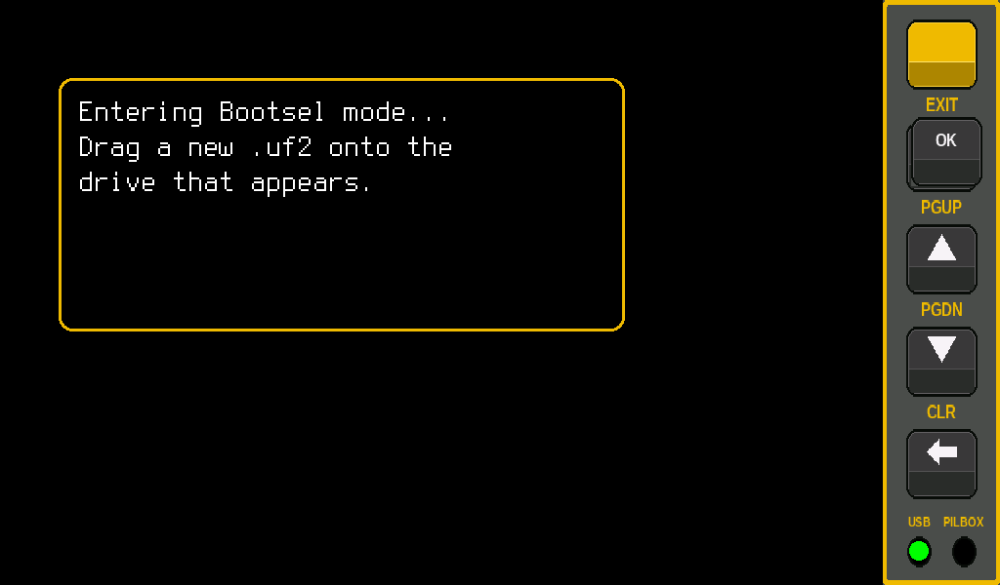</a>

**If HIPI doesn't start at all:** hold the small **BOOTSEL** button on the Pico
board inside while you plug in the USB cable, then do step 3.

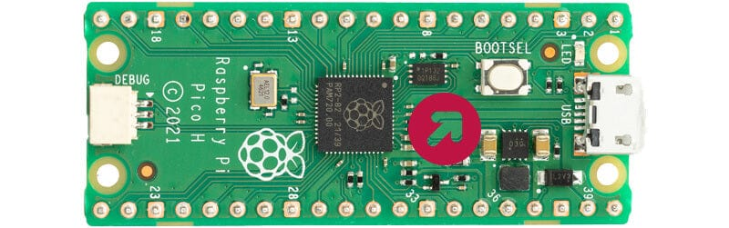

Your settings and files on the SD card are kept. If a new version needs new SD
card files, they are in the SD card zip of that download.

---

## 14. Troubleshooting

| Problem | Try this |
|---------|----------|
| HP-41 can't find the drive or the cassette | Is a cassette chosen (not *No media*)? Is `TFDRIVE` ON in **Devices**, and the switch in the Tape view not OFF? |
| Nothing shows on the screen | Is `TFDISPLAY` ON in **Devices**? Is the Display view chosen (swipe)? |
| Tape view is missing | The tape pictures are missing from the `resources` folder — copy the files from the SD card zip |
| Printer view is missing | `hp82162a.bmp` and `prtparts.bmp` are missing from the `resources` folder — copy them from the SD card zip |
| The HP-41 prints on the printer instead of the display | That's what it does with a printer on the loop — switch `TFPRINT` off (Printer view or **Devices**) |
| The HP-41 doesn't print on the display after changing **Emulate** | Switch the HP-41 off and on (or `AUTOIO`): it finds the display again when it sets up the loop |
| The printer is on, but nothing prints | Switch the HP-41 off and on (or `AUTOIO`): the printer gets its address when the loop is set up |
| Files copied from the PC don't show | Eject the drive on the computer first |
| Screen dump fails | Not possible while **Connect to PC** is on |
| The controller doesn't find HIPI at all, although the loopback test passes | The HP-IL wires may have + and − swapped on both cables — see [Connecting the HP-IL cables](../pcb/README.md#51-connecting-the-hp-il-cables-jp5) |

Still stuck? Choose **Settings → PC link → Trace: On** and connect HIPI to a computer: the
log helps whoever looks at the problem.

---

## 15. Words you may meet

- **HP-IL** — HP's cable system that connects the controller to its peripherals.
- **Loop** — HP-IL devices are connected in a ring, from OUT to IN, back to the
  calculator.
- **Address** — the number the controller uses to reach each device. It hands them
  out by itself.
- **LIF** — the file system used on HP cassettes; `.dat` files contain it.
- **SD card** — the small memory card holding HIPI's cassettes, pictures and
  settings.
- **UF2 file** — a software update for HIPI.
